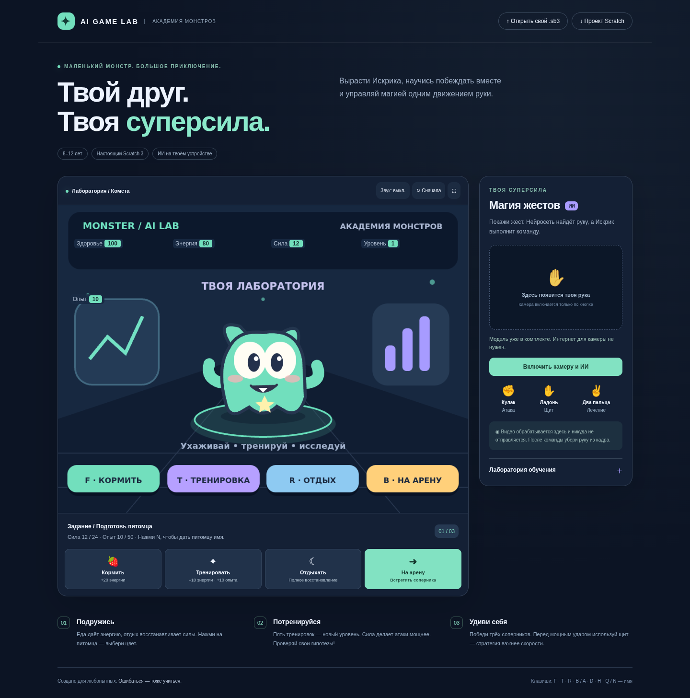

# MONSTER AI LAB — Академия монстров

Учебная игра для **детей 8–12 лет**, рассчитанная на **12 занятий по 45 минут**. Можно сократить до 10 или расширить до 14. Главный герой — Искрик: маленький монстр, которого нужно кормить, тренировать и подготовить к дружеским поединкам. В конце ждёт Громобосс.

**Сама игра написана блоками Scratch 3.** Браузерный плеер исполняет этот же `.sb3`, а не отдельную JavaScript-копию правил. Дети программируют игру в Scratch, преподаватель заранее подготавливает модуль камеры.



## Что открыть сначала

1. Для знакомства с блоками скачайте [Monster_AI_Lab.sb3](web/game/Monster_AI_Lab.sb3). В Scratch 3 выберите **Файл → Загрузить с компьютера**, затем зелёный флажок. Подходит обычный Scratch Desktop или веб-редактор Scratch. Игра полностью работает кнопками без камеры.
2. Для игры с ИИ скачайте [готовый комплект](../downloads/Monster_AI_Lab_Classroom.zip), распакуйте **весь** архив. Нужен Python 3.10+ и современный Chrome/Edge. На Windows запустите `START_WINDOWS.bat`, на macOS/Linux — `python3 start_game.py`. Откроется браузер; окно запуска оставьте открытым. Устанавливать npm-зависимости в готовом комплекте не нужно.
3. Сначала покормите питомца, потренируйте его пять раз, отдохните и нажмите **На арену**. У камеры нажмите **Включить камеру и ИИ**, разрешите видеодоступ.

Не открывайте `index.html` двойным щелчком: загрузке Scratch-проекта и WASM нужен локальный сервер. Интернет после скачивания и распаковки готового комплекта не нужен. Локальную игру не нужно публиковать в интернете для работы камеры.

## Управление

| Действие | Кнопка | Что меняется |
|---|---|---|
| Кормление | F | +20 энергии, +10 здоровья, максимум 100 |
| Тренировка | T | −10 энергии, +2 силы до 24, +10 опыта |
| Отдых | R | Здоровье и энергия становятся 100 |
| Арена | B | Следующий соперник: 60 / 100 / 140 здоровья |
| Атака | A / кулак | −8 энергии; урон = сила + уровень × 2 |
| Щит | D / открытая ладонь | +18 энергии; ответный урон становится 3 |
| Лечение | H / два пальца | −20 энергии; +30 здоровья, затем ответ врага |
| Домой / отступить | Q | Вернуться в комнату; восстановление — кнопкой отдыха |
| Новое имя | N в комнате | Ввести вымышленное имя питомца |
| Цвет | Щелчок по питомцу | Три костюма |

Клавиши приведены для английской раскладки; кнопки на экране работают при любой раскладке. Мощный удар соперника — каждый третий, перед ним есть подсказка. Бой пошаговый: скорость нажатий не даёт преимущества. Победа даёт 30 опыта; каждые 50 опыта повышают уровень. После победы над боссом можно начать новую серию с сохранённой прокачкой; зелёный флажок / «Сначала» сбрасывает игру.

## Что здесь делает ИИ

**Готовая нейросеть MediaPipe Hands** загружается с локального диска вместе с комплектом и находит 21 точку руки. Для стартового управления простые, открытые правила различают согнутые и выпрямленные пальцы: кулак, ладонь, два пальца. Это честное разделение: нейросеть распознаёт руку, а стартовые команды определяет небольшой алгоритм. Мы не выдаём эти три правила за самостоятельно обученную детьми нейросеть.

В «Лаборатории обучения» дети собирают **собственные примеры**. Классификатор **kNN (три ближайших соседа)** использует расстояния между точками руки и учится различать команды по записанным примерам. Нужно минимум по 5 примеров каждого класса; для урока лучше 10–15 с разными положениями руки. Галочка «Использовать мои примеры» включает этот классификатор. Закройте панель обучения, чтобы снова управлять игрой жестами. Пока панель открыта, команды в бой не отправляются.

Удерживайте жест примерно 0,7 секунды, **после каждой команды убирайте руку минимум на полсекунды**. Простое переключение кулака на ладонь без паузы не вызывает новую команду. Лечение при полном здоровье или нехватке энергии не тратит ход. Если команда недоступна, уберите руку перед следующей попыткой.

Камера обрабатывается в браузере; игра не содержит загрузки кадров на сервер, аналитики, регистрации или запроса микрофона. При уходе на другую вкладку камера выключается. Образцы kNN живут только в памяти страницы и исчезают после перезагрузки. API-ключи, платные сервисы и детские аккаунты не нужны.

## Как детям сделать свою версию

- [План преподавателя: 12 уроков, варианты 10 и 14](docs/COURSE_RU.md).
- [Карта переменных, сообщений и блоков](docs/BLOCKS_RU.md).
- [Карточки заданий и проверки](docs/WORKSHEETS_RU.md).
- [01_Pet.sb3](web/game/01_Pet.sb3) — заготовка с персонажем и фоном.
- [04_Care.sb3](web/game/04_Care.sb3) — контрольная точка: уход и тренировки.
- [Monster_AI_Lab.sb3](web/game/Monster_AI_Lab.sb3) — итоговый проект для демонстрации и разбора.

Откройте заготовку в Scratch → измените блоки → сохраните `.sb3`. В плеере нажмите **«Открыть свой .sb3»**: он исполняет вашу изменённую версию. Для подключения камеры сохраняйте исходные переменные и сообщения, а также клавиши A/D/H. Подробности — в карте блоков. `.sb3` сохраняет игровой проект, а веб-модуль камеры остаётся отдельным инструментом. В обычном Scratch камера с ИИ автоматически не появится. Непроверенное расширение Stretch3/TM2Scratch не требуется.

## Сборка из исходников

Нужны Node.js 22+ и Python 3.10+. Из папки `monster-ai-lab`:

```sh
npm ci
npm run build
npm start
```

Адрес печатает сервер (порт 8000). `npm run build` собирает Scratch-проекты и копирует движок, WASM и нейромодели из закреплённых npm-пакетов в `web/vendor`. `node_modules` и `web/vendor` не коммитятся. Сам `.sb3` и готовый ZIP входят в репозиторий.

```sh
npm test
npm run test:browser
python3 tools/package_classroom.py
```

Браузерные проверки требуют запущенного `npm start`, Playwright из devDependencies и Chromium. По умолчанию используется `/usr/bin/chromium`; другой путь задаётся переменной `CHROMIUM_PATH`. `LAB_URL` меняет адрес тестируемого сервера. Эти инструменты нужны разработчику, детям — только Scratch.

## Проверки и ограничения

Проверки правил выполняются в настоящем Scratch VM: прокачка, ограничения энергии, защита, полная кампания, босс, поражение и восстановление. Браузерный тест проверяет отрисовку, оба вида кнопок, имя, бой, локальную загрузку нейромодели и обработку искусственной камеры без руки, выключение камеры и мобильную вёрстку. Он **не заменяет проверку настоящих жестов человека**. Перед уроком проверьте три жеста на каждой камере, освещение и разрешение доступа. Для демонстрации лучше ноутбук; медленный планшет может не справиться с моделью.

Это готовый учебный пример, а не коммерческая игра: прогресс не сохраняется между перезагрузками, нет онлайн-боёв, чата или генеративного ИИ. На уроках оцениваем объяснение алгоритма и эксперименты, а не скорость прохождения.

Исходники и лицензии: [THIRD_PARTY.md](THIRD_PARTY.md). Проект не является официальным продуктом Scratch Foundation или Google.
