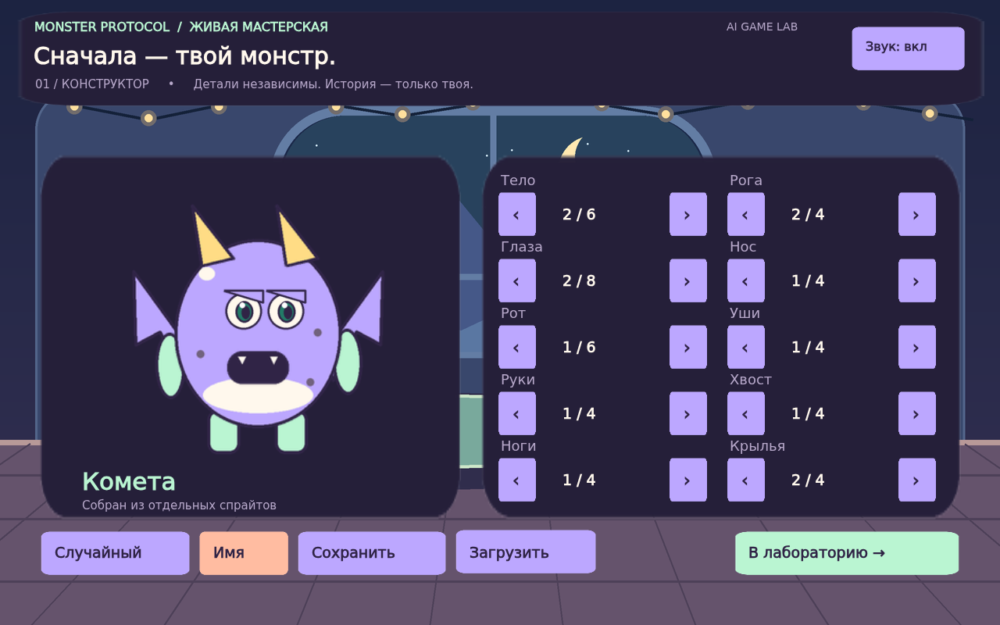

# MONSTER PROTOCOL · AI GAME LAB

**Актуальная версия — GDevelop.** Старый MONSTER AI LAB на Scratch остаётся
отдельным проектом в другой папке. Открывайте `monster-protocol`, если вам
нужны конструктор из частей и подключение Teachable Machine.

Обновление 1.1: новые иллюстрированные площадки, три разных соперника,
рывки и летящие заряды, видимый ответный удар и числа урона. Камера умеет
автоматически брать встроенную модель карточек, а файлы своей модели можно
добавлять по одному — список показывает, что уже выбрано и чего не хватает.

**Собрать своего монстра → научить заботе и тактике → обучить команды камеры.**
Локальный курс GDevelop для детей **8–10 лет, 12 занятий по 45 минут**.



## Что скачать

| Комплект | Для кого | Содержимое |
|---|---|---|
| [Monster_Protocol_Demo.zip](downloads/Monster_Protocol_Demo.zip) | Показать детям результат | Готовая игра в браузере, исходный проект GDevelop, локальная модель цветных карточек, инструкция запуска |
| [Monster_Protocol_Student.zip](downloads/Monster_Protocol_Student.zip) | Раздать каждому ученику | Независимый редактируемый проект, детали, два образца событий, задания и справочник |
| [Monster_Protocol_Teacher.zip](downloads/Monster_Protocol_Teacher.zip) | Преподавателю | Оба проекта, готовая игра, подробный курс, карточки заданий, подключение ИИ, контрольные результаты |

Скачайте архив через **Download raw file / Скачать**, распакуйте **всю папку**.
Двойной щелчок по `game.json` в проводнике может открыть текст: открывайте файл через GDevelop.

## Показать готовую игру

1. Распакуйте демонстрационный архив.
2. Откройте `START_WINDOWS.bat` (нужен установленный Python 3.10+, доступный как `py` или `python`). На macOS/Linux: `python3 start_demo.py`.
3. Либо без Python: откройте `project/game.json` в настольном GDevelop **5.6.269 или новее** и нажмите **Предпросмотр**.
4. Соберите героя стрелками, задайте имя. В лаборатории кормите, тренируйте, отдыхайте; на арене победите трёх соперников. Игра пошаговая: соперник отвечает только после допустимой команды.
5. Для показа ИИ на арене: `ИИ / камера` → `Включить камеру`. Если своя модель ещё не загружена, встроенная модель карточек загрузится автоматически. Красная карточка — атака, синяя — щит, зелёная — лечение. Нейтральный фон — IDLE. Показывайте карточку близко, чтобы она занимала центральный квадрат кадра; между командами убирайте её.

Цветовая модель действительно исполняет нейросеть, но обучена на **синтетических цветах**, а не на руках или детях. Для конкретной камеры требуется проба. На уроках ученики обучают собственную модель в Teachable Machine и загружают её локальные файлы. Игра не требует токенов, сервера ИИ или платного API.

## Открыть ученический шаблон

`student-template/game.json` — отдельный проект, не ссылка на демонстрацию.
В нём 4 сцены и 10 категорий деталей, включая **два экземпляра MonsterEyes**.
Каждая деталь — обычный Sprite; каждый вариант — отдельная анимация с одним кадром.
Дети могут двигать/масштабировать части прямо в редакторе; позиции адаптером не перезаписываются.

Готовы только примеры стрелки **тела вправо** и **глаз вправо**, отображение вариантов, имя и локальное сохранение. Остальные стрелки, случайный выбор, переход в лабораторию, уход, тренировки, бой и финал — задания курса. Камерный адаптер преподавателя уже встроен в заготовки сцен; игровые события для его команд дети добавят позднее.

## Преподавать

- [Подготовка ноутбуков и демонстрация на первом занятии](docs/TEACHER_START_RU.md).
- [Подробный план всех 12 занятий](docs/LESSONS_RU.md).
- [Точные события, формулы, порядок выполнения](docs/EVENTS_RU.md).
- [Teachable Machine: обучение и подключение](docs/AI_RU.md).
- [Карточки ученика и проверка проекта](docs/STUDENT_CARDS_RU.md).
- [Что реализовано и что уточнено относительно переписки](docs/DESIGN_RU.md).
- [Выполненные проверки и ограничения](docs/VALIDATION_RU.md).

Дети собирают свои игры из готовых графических ресурсов и обычных событий GDevelop. **JavaScript они не пишут**: группа `99 · Готовый модуль преподавателя` обслуживает имя, сохранение, модель и дополнительные визуальные эффекты. Игровые правила видны в группах 01–04, редактируются в редакторе событий. Эффекты не меняют здоровье или результаты боя. Все изображения созданы для этого комплекта; исходная папка Kenney из переписки не была приложена и не используется.

## Разработка и воспроизведение сборки

Нужны Node.js 24, Python 3.10+, Pillow и Chromium. Ученикам Node.js и npm не нужны.

```sh
python3 -m pip install -r tools/requirements.txt
npm ci --cache /workspace/.npm-cache
npm run generate
npm run export
npm run serve
# В другом терминале, из monster-protocol:
npm test
npm run package
```

Экспорт идёт настоящим ядром GDevelop 5.6.269 через закреплённый `gdcore-tools`, а не отдельной HTML-имитацией игры. `build/` и результаты тестов игнорируются; готовый браузерный экспорт находится в ZIP. Генератор перезаписывает **только оба проекта этого комплекта**: не запускайте его поверх ученических изменений. Для редактирования используйте GDevelop.

[Лицензии](THIRD_PARTY.md). Предыдущий Scratch-проект оставлен в репозитории как отдельная работа.
